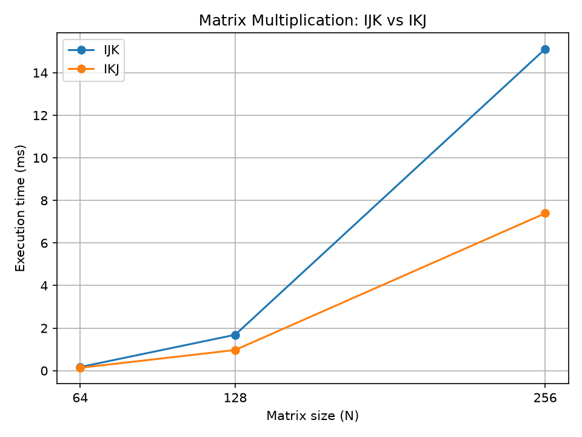
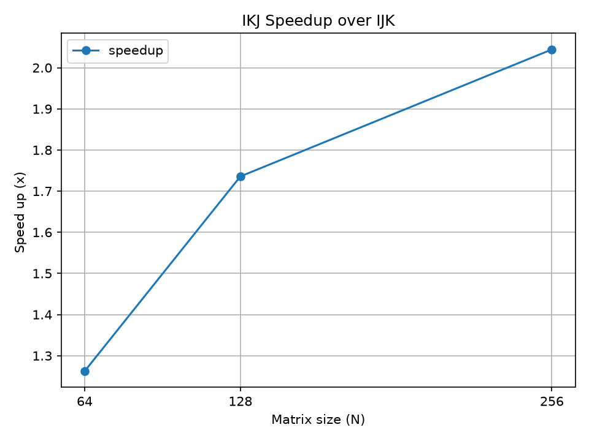

# CPU Cache Locality & Matrix Multiplication Benchmark

A C++17 performance engineering project investigating how memory access patterns and loop ordering affect CPU performance in dense matrix multiplication.

## 1. Overview

This project compares two implementations of naive matrix multiplication:

- **IJK:** Loop order `i → j → k`
- **IKJ:** Loop order `i → k → j`

Both algorithms have \(O(N^3)\) time complexity, but exhibit different memory access patterns when processing row-major matrices.

The goal is to evaluate their relative performance while maintaining numerical correctness.

## 2. Experimental Environment

| Component | Specification |
|---|---|
| CPU | Intel Core i5-11400H |
| CPU Cores / Threads | 6 / 12 |
| L1 Data Cache | 288 KiB total |
| L2 Cache | 7.5 MiB total |
| L3 Cache | 12 MiB |
| OS | Linux Mint 22.3 |
| Compiler | GCC 13.3.0 |
| Language | C++17 |
| Optimization | `-O2` |

The implementations are single-threaded.

## 3. Implementation

Matrices are stored as contiguous `std::vector<double>` arrays in row-major order.

**IJK:** The innermost loop iterates over `k`, accessing elements of matrix B with a stride of N.

**IKJ:** The innermost loop iterates over `j`, accessing consecutive elements of B and C.

The IKJ access pattern is generally more favorable for spatial locality and CPU cache utilization.

## 4. Benchmark Methodology

- Two warm-up iterations per benchmark invocation.
- Eleven timed repetitions using `std::chrono::steady_clock`.
- Median of the eleven measurements.
- Four benchmark trials with alternating algorithm order.
- Final result calculated as the median of four trial medians.
- Output matrices preallocated before timing.
- Output buffers reset outside the timed region.
- Computed results consumed after timing to help prevent dead-code elimination.

Correctness is verified using known multiplication results, identity matrices, zero matrices, and floating-point tolerance comparisons.

## 5. Experimental Results

| Matrix Size | IJK (ms) | IKJ (ms) | IKJ Speedup |
|---|---:|---:|---:|
| 64 | 0.170 | 0.135 | 1.262× |
| 128 | 1.686 | 0.971 | 1.736× |
| 256 | 15.114 | 7.393 | 2.044× |

Speedup is calculated as:

`IJK execution time / IKJ execution time`

### Execution Time



### Speedup



## 6. Observations

IKJ outperformed IJK for all three tested matrix sizes in this experimental run.

At N = 256, IKJ achieved approximately **2.04× speedup**, reducing execution time from 15.114 ms to 7.393 ms.

The results are consistent with improved spatial locality from sequential memory accesses. However, cache misses were not directly measured using hardware performance counters.

## 7. Reproduction

Compile from the project root:

```bash
mkdir -p build results

g++ -std=c++17 -O2 -Wall -Wextra -Wpedantic \
    src/matmul.cpp -o build/matmul
```

Run the benchmarks:

```bash
printf "64\n" | ./build/matmul
printf "128\n" | ./build/matmul
printf "256\n" | ./build/matmul
```

Results are appended to `results/matmul_results.csv`.

Generate visualizations:

```bash
python -m pip install matplotlib
python scripts/plot_results.py
```

The plotting script should be executed from the project root.

## 8. Limitations & Future Work

- Benchmarks were conducted on one CPU architecture.
- CPU frequency scaling and background processes may introduce timing variability.
- Only three matrix sizes were evaluated.
- Input matrices use deterministic, patterned values.
- The benchmark does not directly measure cache misses.
- Compiler optimizations may affect measured performance.

Future improvements include cache-blocked matrix multiplication, hardware performance counter profiling with Linux `perf`, SIMD/vectorization analysis, and parallel implementations.

## 9. Technologies

C++17 · GCC · STL · CPU Cache Locality · Performance Benchmarking · Python · Matplotlib